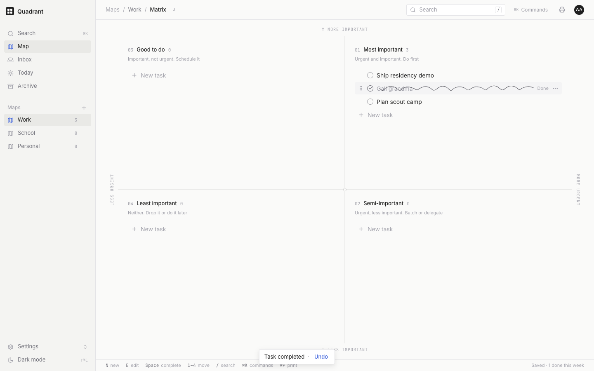

# Quadrant

**Everything has a place. Today has three.**

A calm, text-first to-do app built on one urgency × importance map, a daily top three, and
color-coded life categories. It runs in the browser with no account and stores everything locally.

## Demo & source

| | |
| --- | --- |
| **Live demo** | <https://quadrants-nine.vercel.app> (landing at `/`, app at `/app`) |
| **Source** | <https://github.com/Mulla759/quadrants> (public) |



*Current MVP (2026-11-22, synthetic demo data): tasks triaged into the four urgency × importance quadrants; "Call grandma" is completed with the hand-drawn scribble.*

**Role & maturity.** I'm **Abdullahi Abdi** ([@Mulla759](https://github.com/Mulla759)), the developer of this implementation; the concept and paper system are credited to Isabel (Agent 28) below. Status: **current MVP** — feature-complete per the M-1…M-15 checklist in [`docs/AGENT.md`](docs/AGENT.md), single-user and local-first, deployed on Vercel. See the [portfolio documentation](documentation/README.md) for role details, evidence labels, and known gaps.

## The origin

Quadrant exists because of **Isabel**, also known as **Agent 28** ([@invinciblevenus_](https://www.tiktok.com/@invinciblevenus_)).
She shared the paper system she actually runs her life on in a
[whiteboard walkthrough](https://www.tiktok.com/@invinciblevenus_/video/7641595518291954977?q=invinciblevenus_%20whiteboard%20system&t=1791181900603):

- **Urgency × importance quadrants.** Every to-do is sorted into four boxes: do first, schedule
  it, batch it, or drop it. A broken sink is urgent and important; a yearly deep-clean of a fake
  tooth is important but not urgent; planning the scout camp program due in three weeks is urgent
  but not important.
- **Life categories in color.** Four life areas: scouting, uni/work, private life, and side
  quests. Each gets its own pen color (uni tasks in purple, titles in brown). Done tasks are
  crossed out or deleted to keep the list quiet.
- **A daily top three.** Three tasks are boxed at the top, drawn from work or private life, plus
  three side quests for rest and play. Unfinished picks stay in the box until they are done.

Her system genuinely changed how I run my life: a pile of guilt became four quiet decisions and
three things a day. I'm an aspiring computer science major, and I wanted to bring that whiteboard
to the screen, so Quadrant keeps the map, the colors, and the top three, and makes them
keyboard-fast and private by default.

All credit for the original idea and the paper system goes to **Isabel (Agent 28, @invinciblevenus_)**.
Quadrant is an independent, unaffiliated tribute, free to use under the [Apache-2.0 license](LICENSE).

## What's inside

- Four-quadrant map: 01 Most important · 02 Semi-important · 03 Good to do · 04 Least important
- Inline capture (`N`), edit (`E`), triage by drag or `1`–`4`, complete (`Space`, scribble, undo)
- Up to 8 muted-color life categories, shown as a dot on each row
- Today: top three + side quests, with carry-over
- Multiple maps, Inbox, Archive (auto-archive after 7 days)
- IndexedDB persistence, fully offline, "Saved" status, JSON export/import
- Keyboard shortcuts, `/` search, ⌘K command palette, ⌘P print sheet, dark mode, installable PWA

## Quick start

```sh
pnpm install
pnpm dev        # http://localhost:5173/ (landing) · http://localhost:5173/app (app)
pnpm test
pnpm build
```

Validation (run in CI on every push to `main` and on PRs — `.github/workflows/ci.yml`):

```sh
pnpm install --frozen-lockfile
pnpm typecheck   # tsc --noEmit across packages
pnpm test        # vitest: core + web (see documentation/engineering.md)
pnpm build       # turbo: core then web → packages/web/dist
```

## Portfolio documentation

For reviewers: start at [`documentation/README.md`](documentation/README.md) (review guide + rubric-to-evidence checklist), then the [case study](documentation/case-study.md), [decisions](documentation/decisions.md), and [engineering notes](documentation/engineering.md). Screenshots live in [`documentation/assets/`](documentation/assets/) — all captured from the real running app with synthetic demo data, labeled and dated.

## Structure

```
design/landing  exported design references for the landing page
docs/           project docs: agent notes, design system, browser support
packages/core   @quadrant/core · data model, Yjs docs, IndexedDB, ordering, daily plans
packages/web    @quadrant/web  · React + Vite + Tailwind (landing at /, app at /app)
```

Design source of truth is `~/Documents/quadrant.pen`; see [`docs/DESIGN.md`](docs/DESIGN.md).
Agent and API notes live in [`docs/AGENT.md`](docs/AGENT.md); every doc is indexed in
[`docs/`](docs/README.md).

## Roadmap

- **MVP**: the local single-user system above.
- **V1**: share a map by link, live presence over WebSockets (Hocuspocus + Postgres).
- **V2**: optional login (backup/sync), Expo mobile apps, home-screen widgets.

## Known limitations

- **Single device.** Local-first by design: data lives in your browser's IndexedDB, no account, no sync (roadmap V1/V2).
- **Desktop-first layout.** The landing is pixel-designed for wide screens; it remains usable in narrow panes but looks best on desktop.
- **No analytics.** Deliberately no tracking, so usage outcomes are unmeasured — see the [results gap](documentation/case-study.md#6-results) in the case study.

## Credits & license

Original concept and paper system: **Isabel (Agent 28, [@invinciblevenus_](https://www.tiktok.com/@invinciblevenus_))**.
Digital implementation: **Abdullahi Abdi** ([@Mulla759](https://github.com/Mulla759)). Licensed under [Apache-2.0](LICENSE).
