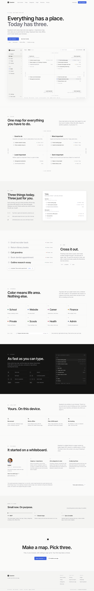
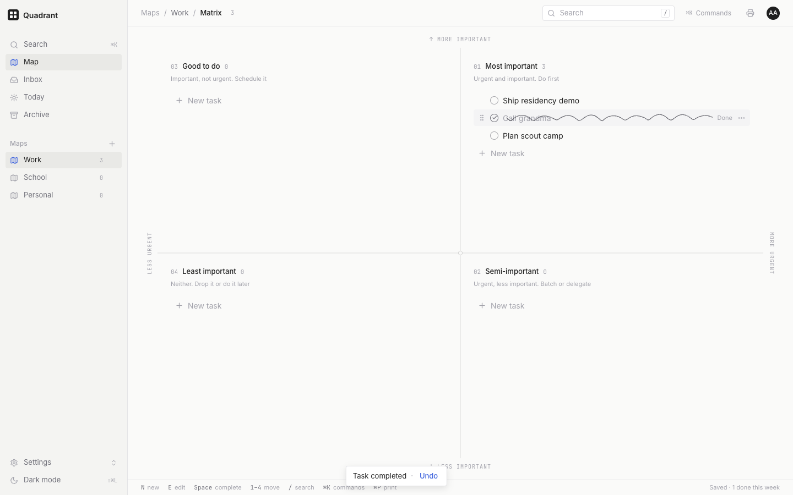
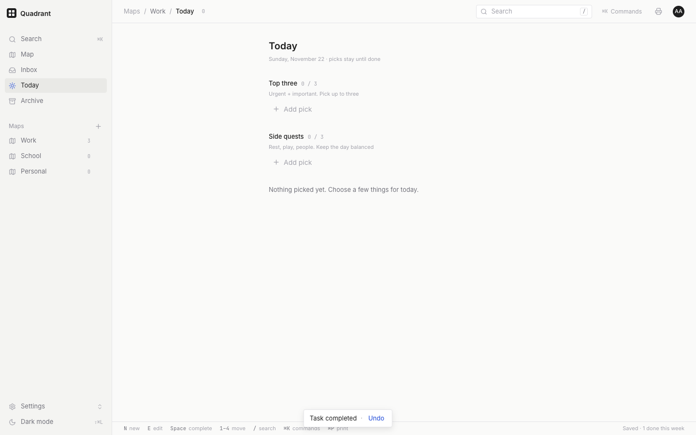
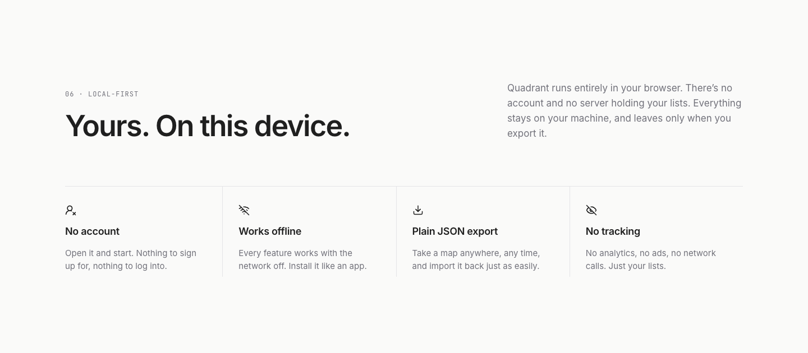
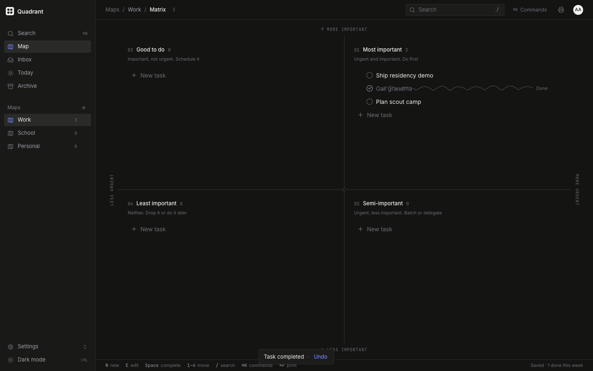

# Quadrant — Product case study

> **Evidence labels:** **Verified** = traceable to a file/commit/test/reproducible check · **Hypothesis** = plausible but unvalidated · **Planned** = proposed future work · **Missing** = no evidence exists.

## 1. Problem and opportunity

**The user.** Me — a computer science student with a full plate: coursework, a job hunt, private life, and scouts. The app also speaks to anyone with too many mixed-priority to-dos and no system for choosing what matters today. **(Verified:** the origin story and target-user framing come from the [README](../README.md); broader-market framing beyond me is a **Hypothesis**.)**

**The pain point.** A long mixed list of tasks turns into guilt: everything feels urgent, nothing gets finished, and the day ends without a sense that the right things happened. **(Verified:** this framing is in the README's origin section, written by me at build time.)**

**Existing alternatives.** The direct inspiration is a paper whiteboard system by Isabel ([@invinciblevenus_](https://www.tiktok.com/@invinciblevenus_)), demonstrated in a [public walkthrough video](https://www.tiktok.com/@invinciblevenus_/video/7641595518291954977): an urgency × importance map, color-coded life areas, and a daily top three. General to-do apps (Todoist, Things, Notion) exist, but they are account-based, feature-dense, and don't encode this specific system. **(Verified:** the video link and credit are in the README. No competitive analysis was documented — the comparison above is a **Hypothesis**.)**

**The opportunity.** **(Hypothesis, not measured.)** Quadrant is free, local, private by default, and keyboard-fast. The plausible paths to value are (1) being the simplest digital version of a method that already has an audience, and (2) the roadmap's V1/V2 steps (shareable maps, optional sync login, mobile). No revenue or growth model is claimed.

## 2. My contribution and constraints

**Role.** I'm **Abdullahi Abdi** ([@Mulla759](https://github.com/Mulla759)), the developer of the digital implementation. The original concept and paper system are credited to Isabel (Agent 28); the README states this explicitly. Git history supports single-developer ownership: all 20 commits from `53cda7c` (2026-09-28) to `ee7a8f5` (2026-11-17) are authored by one GitHub account. **(Verified via `git log --format="%an <%ae>" --all | sort -u`.)**

**Timeline.** Initial commit 2026-09-28; core data layer and web MVP merged 2026-10-01; landing page built across feature branches and merged via PR #1 on 2026-10-05; docs reorganized 2026-10-05; landing/animation refinements 2026-11-17. **(Verified via [git-log.txt](assets/git-log.txt).)**

**Constraints.** Solo, part-time project; no backend budget; the brief was "digital version of the paper system" with fidelity to a visual design source (`design/landing/reference.html`, exported from a .pen design file). Local-first and no-account are deliberate scope choices, not just constraints.

## 3. Discovery

| Evidence | Source | Insight | Decision it informed |
| --- | --- | --- | --- |
| Isabel's whiteboard walkthrough: urgency × importance quadrants, colored life areas, daily top three | [TikTok video](https://www.tiktok.com/@invinciblevenus_/video/7641595518291954977), credited in [README](../README.md) **(Verified)** | A pile of guilt becomes four quiet decisions and three things a day | The entire MVP concept: map + top three + categories |
| Interview: Abdikarim Mohamed struggles with *coordinating* his planning and said the system would change the way he does planning | [Feedback log](feedback.md#entry-1--abdikarim-mohamed) **(Verified that the interview was reported to me; the conversation itself was informal, n = 1, no transcript/date)** | The coordination pain point exists outside my own use; the method reads as a meaningful change, not another list app | Confidence in the core concept for users beyond the author; motivation for ongoing validation |
| A pixel-level design reference exported from `quadrant.pen` | [`design/landing/reference.html`](../design/landing/reference.html) and section exports, [docs/DESIGN.md](../docs/DESIGN.md) **(Verified)** | The visual system is defined: tokens, spacing, typography, interaction states | Fidelity-driven implementation; sections are self-contained files mirroring design frames |

**Gap (Partial).** User research is real but thin: one published system demo and one informal interview (n = 1). There are no surveys, usability tests, or usage analytics yet. Collection is ongoing in the [feedback log](feedback.md). **Planned validation activity:** a 5-person think-aloud usability test on the core loop (capture → triage → complete → today), plus an opt-in feedback link in the app's settings, both recorded as dated entries in the log. That is cheap, real, and would convert several **Hypothesis** claims above into **Verified** ones.

## 4. MVP definition

**Success criteria (Hypothesis — proposed before any measurement):** a person who knows the paper system can switch to the digital one in under a minute; the core loop — capture a task, sort it into a quadrant, pick today's three, cross things out — works fully offline with no account; data survives refreshes and browser restarts.

**Scope boundary.** The MVP checklist lives in [docs/AGENT.md](../docs/AGENT.md) (M-1…M-15): four-quadrant map, inline create/edit, drag + keys 1–4, scribble-complete with 5-second undo, up to 8 muted-color categories, daily top three + side quests with carry-over, multiple maps, Inbox, 7-day auto-archive, IndexedDB + offline, JSON export/import, shortcuts + search + dark mode, ⌘K palette, task detail, installable PWA. **Excluded:** accounts, teams, permissions, billing, subtasks, recurrence, cloud sync (moved to the V1/V2 roadmap). **(Verified:** the checklist is committed in the repo.)**

## 5. MVP walkthrough (Current MVP)

Screenshots captured **2026-11-22** from the running app at commit `ee7a8f5` (+ portfolio docs, uncommitted at capture time). All data shown is **synthetic demo data** seeded in a throwaway browser profile; no real user data is depicted. Label: **Current MVP** — there is no separate "original MVP" artifact, so no historical comparison is made.

*The entry point (landing at `/`). Explains the user need — one map, today has three — and links into the app. Supports the product framing requirement and decision **D04** (one app serves both landing and product).*

*The central workflow (app at `/app`): tasks triaged into the four urgency × importance quadrants. "Call grandma" is completed, showing the scribble + fade (M-5). The task list is synthetic. Supports **M-1/M-2/M-5** and decisions **D01/D03**.*

*The Today view (`/app` → Today) — the daily top three plus side quests (M-7). Captured in its empty state (picks are chosen per task, so a fresh profile shows none): a visible limitation of the demo, honestly shown rather than staged.*

*The local-first section of the landing: everything is stored on-device, works offline, exports/imports JSON. This is both a selling point and a hard constraint — no sync, no accounts (M-10/M-11, decision **D01**).*

*Dark mode (`⇧⌘L`, M-12) — the one visible theme iteration in the MVP. Included as evidence of polish scope rather than a near-duplicate screenshot.*

## 6. Results

**Technical outcomes (Verified):**
- Live deployment (URL in [README](../README.md)); public source at [github.com/Mulla759/quadrants](https://github.com/Mulla759/quadrants).
- Checks passing at commit `ee7a8f5` + this portfolio's changes: `pnpm typecheck`, `pnpm test` (36 tests: 20 core + 16 web, see [engineering.md](engineering.md#testing)), `pnpm build`. CI runs the same steps on GitHub Actions.
- A real defect found and fixed during this task with before/after measurements — see [engineering.md](engineering.md#technical-challenge).

**User and business outcomes (Missing).** By design the app has no accounts and no analytics, so there are no users, retention, or revenue numbers — none are claimed. **Measurement plan (Planned):** (1) opt-in, privacy-preserving event counters (tasks created, completions, days with a full top three) behind an explicit setting, reported as dated exports; (2) count of installs/PWA and feedback messages; (3) a short link-out survey after export/import. Each would be recorded with date, sample size, and definition.

## 7. Next steps

Ordered by the uncertainty or weakness each one addresses:

1. **Validate with real users** (5-test usability plan above) — addresses the biggest gap: discovery and product-market framing. *Signal to continue: most testers complete the capture→triage→complete loop unassisted and report the "quieter" feeling the product promises.*
2. **Opt-in event counters** — turns "no results" into dated, sample-sized product numbers. *Signal: baseline funnel data exists for later changes.*
3. **V1: shareable maps with live presence (Hocuspocus + Postgres)** — already designed for via Yjs docs; the largest user-facing unlock. *Signal: usability testers ask to share or sync.*
4. **Mobile (Expo) + optional sync login (V2)** — the most common way paper-system users would actually live with it. *Signal: desktop usage is retained, and feedback requests sync.*
