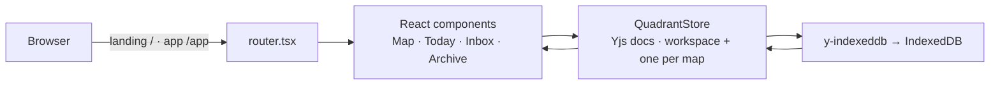

# Quadrant — Engineering evidence

> **Evidence labels:** **Verified** = traceable to a file/commit/test/reproducible check · **Hypothesis** = plausible but unvalidated · **Planned** = proposed future work · **Missing** = no evidence exists.

## Architecture

Quadrant is a pnpm + Turborepo monorepo: a framework-agnostic core package and a React/Vite web app. There is no backend — persistence is local-first.



- **`packages/core`** (`@quadrant/core`) — data model, Yjs documents, IndexedDB persistence, ordering (fractional-indexing), daily plans. UI-agnostic, unit-tested. Key file: [`packages/core/src/index.ts`](../packages/core/src/index.ts).
- **`packages/web`** (`@quadrant/web`) — React 18 + Vite 6 + Tailwind 4. Two surfaces in one app: the landing page (composition in `LandingPage.tsx`, one file per section under `src/landing/sections/`) and the app (`src/App.tsx`, `src/components/**`), routed by a ~30-line dependency-free router ([`src/router.tsx`](../packages/web/src/router.tsx)). Installable PWA via `vite-plugin-pwa`.
- **The scribble engine** ([`src/lib/scribble.ts`](../packages/web/src/lib/scribble.ts)) — a parametric loop-curve drawn to canvas with progress-based animation, honoring `prefers-reduced-motion`. Used by both the app's task completion and the landing page's animated sections. Unit-tested.

Engineering choices worth inspecting: a tiny store over `useSyncExternalStore` instead of a state library; Yjs now (not later) so V1 multiplayer doesn't require a data migration; sections kept self-contained (single responsibility) per the [landing README](../packages/web/src/landing/README.md).

## Technical challenge (found and solved during this task)

**Dated 2026-11-22, labeled: this is a real defect discovered and fixed while preparing this portfolio, not a historical challenge.**

**Symptoms.** The landing page's "Cross it out." section appeared *invisible* in a narrow (~734 px) browser pane, and its completion animation either never played or finished before the viewer arrived. In the narrow pane the task list column measured **0 px wide** (`getBoundingClientRect().width === 0`), so content existed in the DOM but was rendered at zero width; the entrance animation also gated visibility on an IntersectionObserver that couldn't fire reliably against a zero-width target.

**Investigation.** Measured in the running app via browser probes: at 734 px viewport, the section's fixed 400 px text column + 112 px gap + 232 px page padding exceeded the available width, so the `flex-1` list collapsed to 0. The observer used a 12%-visibility threshold over the whole tall section, which triggered while scrolling past, so the ~2-second sequence (rows → check-pop → scribble → toast) finished before the section was actually in front of the user — they only ever saw the final state.

**Constraints.** Preserve the pixel design (fixed column widths, exact spacing tokens) at desktop sizes; no layout library to lean on; keep animations disabled for `prefers-reduced-motion`; the sequence must remain demonstrable for reviewers without reloading.

**Alternatives considered.** (a) full responsive breakpoints for the whole landing — highest fidelity but touches every section, out of proportion for the defect; (b) one-shot animation only — the original behavior, unsatisfying; (c) scaling down the design at narrow widths — violates the design source of truth.

**Solution.** Three focused changes ([commit `ee7a8f5`](https://github.com/Mulla759/quadrants/commit/ee7a8f5)):
1. `flex-wrap` on the section's container — the list wraps instead of collapsing; no breakpoints, desktop untouched.
2. The observer now watches the whole `<section>` and reports every enter/exit; a run counter restarts the completion sequence on each re-entry (rows stay revealed once shown; the scribbles, check-pops, and toast replay).
3. Reduced-motion path renders the final state immediately; in the app, the check-mark pop fires only on the user's toggle, not on initial render of already-done tasks.

**Validation (Verified, same session).**
- At 734×983: left column went from **0 px → 502 px** after the fix; all rows visible.
- Replay probes: after scrolling away and back, Done-section canvases went **0 → 2 → 3**, then stayed 3 — the sequence resets and redraws.
- App completion: the check icon carried `animation-name: check-pop` for the pop window, and the scribble canvas painted **0 → 2,115** non-transparent pixels as the stroke drew.
- `pnpm typecheck`, `pnpm test`, `pnpm build` all green (see below).

## Testing

| Layer | Tests | What they establish | Where |
| --- | --- | --- | --- |
| Core logic | 20 tests | Data model invariants: quadrants, ordering, completion/undo, daily-plan carry-over, archiving — the riskiest pure logic | [`packages/core/src/index.test.ts`](../packages/core/src/index.test.ts) |
| Scribble engine | 3 tests | Curve/path generation and progress math used by every animated scribble | [`packages/web/src/lib/scribble.test.ts`](../packages/web/src/lib/scribble.test.ts) |
| Browser support | 8 tests | Graceful degradation checks across the supported browser matrix | [`packages/web/src/lib/browser.test.ts`](../packages/web/src/lib/browser.test.ts) |
| Landing Done section | new this week | The completion sequence: rows render unchecked, then 3 scribbles appear on entry, the toast reveals, the sequence replays on re-entry, and reduced motion shows the final state immediately | `packages/web/src/landing/sections/DoneSection.test.tsx` |

**Commands and actual results (run locally 2026-11-22, at commit `ee7a8f5` + this portfolio's changes, pnpm 10.32.1 / Node 22.16.0):**

```
pnpm install --frozen-lockfile   # pass (631ms; pre-existing "Ignored build scripts: esbuild" notice, harmless)
pnpm typecheck                   # pass — tsc --noEmit across packages
pnpm test                        # pass — 36 tests: core 20, web 16 (8 browser + 3 scribble + 5 DoneSection)
pnpm build                       # pass — tsc + vite build → packages/web/dist (2.17s, PWA files generated)
```

CI (`.github/workflows/ci.yml`, added this week) runs the same four steps on push to `main` and on pull requests. **Local runs are verified; the workflow itself is configured for future runs** — its first green run is confirmed in the GitHub Actions tab after this push.

**Remaining gaps (honest):** no end-to-end browser test of the full user journey (create → triage → complete → today), no visual regression tests for the design fidelity, and `@quadrant/core`'s IndexedDB layer is exercised only through its pure logic tests, not a real browser storage test.

## Version-control evidence

- **21 commits, 2026-09-28 → 2026-11-17**, one author account, feature-branch workflow with merges (`feat/core`, `feat/web`, `feat/mvp`, `feat/landing` + split branches `feat/landing-a/-b/-shell`) and **one real pull request: #1** (landing merge into `main`). Full listing: [assets/git-log.txt](assets/git-log.txt); graph: [assets/git-tree.txt](assets/git-tree.txt).
- Genuine history is preserved — no rewrites, no force-pushes, no squashing for appearance. The portfolio work lands as new reviewable commits on top.

## Current technical limitations

1. **No sync/multi-device** (deliberate, D01) — the biggest product ceiling; V1 (share links + presence) is the designed remedy, enabled by the Yjs foundation.
2. **Desktop-first layout** — the landing was designed pixel-perfect for wide screens; the narrow-pane fix made it usable, not beautiful, at phone sizes (Expo apps are the roadmap answer).
3. **No e2e tests** — see gap above; Playwright smoke of the core journey is the most useful next investment.
